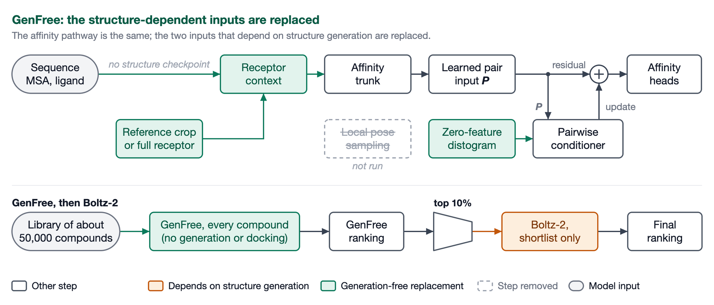
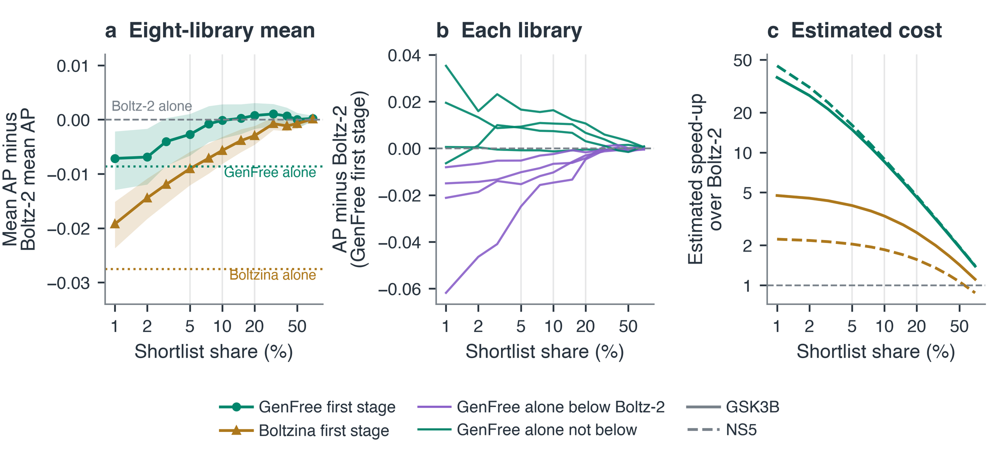

# Boltz-GenFree

Structure-generation-free Boltz-2 affinity screening.

Boltz-GenFree (GenFree) runs the released Boltz-2 affinity trunk and heads directly
from processed receptor and ligand inputs. It builds no structure for any candidate,
replaces the local affinity distogram with zero features, and writes compact scores
for large, resumable virtual screens. It is intended as a cheap first stage: rank the
whole library with GenFree, then spend the full Boltz-2 pipeline only on the top of
the ranking.



GenFree needs a receptor context. A short receptor is used in full; a longer one is
cropped using a supplied reference complex, which only selects receptor sequence
blocks and gives the model no ligand pose or structure-derived distogram.

## Performance



## Install

Python 3.10 or newer. The package is not on PyPI; install from a tagged release or
pinned commit.

```bash
git clone https://github.com/N283T/boltz-genfree.git
cd boltz-genfree
uv sync --frozen --extra cuda      # --extra cuda12 for CUDA 12 PyTorch builds
source .venv/bin/activate
```

This installs the `boltz-genfree` command, not the upstream `boltz` command. The
Boltz-2 affinity checkpoint and component dictionary are downloaded on first use;
model weights are not redistributed.

## Screen a ligand library

Write a config with one protein and one ligand source:

```yaml
version: 1

target:
  sequence: YOUR_PROTEIN_SEQUENCE
  msa: ./target.a3m          # or auto / empty
  crop:                      # optional when the complete receptor fits
    reference: ./reference-complex.cif
    reference_protein: A
    reference_ligand: L
    budget: per_ligand

ligands:
  csv: ./library.csv
  id_column: id
  smiles_column: smiles

output_dir: ./screen-output
chunk_size: 1000

options:
  seed: 20260718
  affinity_recycling_steps: 0
  ligand_reference_conformer: skip
```

```bash
boltz-genfree screen screen.yaml --prepare-only   # dry run: validate, write screen_plan.json
boltz-genfree screen screen.yaml                  # run; aggregates into scores.csv
```

- **Resume.** A re-run with the same inputs resumes from provenance-checked outputs.
  A changed target, ligand source, MSA or preprocessing limit is rejected, not mixed.
- **Progress.** `screen_status.json` is updated after every batch and can be read
  from another terminal.
- **Reproducibility.** With a fixed `options.seed`, a record receives the same score
  regardless of chunk boundaries, workers or resumption.
- **MSA.** `msa: auto` calls the MSA server once per target, never per compound.

Ligand sources (exactly one under `ligands`): `csv`/`tsv` (configurable `id_column`,
`smiles_column`, `delimiter`), `sdf` (with `id_property`; coordinates are not reused),
`smiles` (inline list), or `ccd` (component codes). Paths are relative to the config.

## Options and limits

Main `options` keys: `seed`, `devices`, `num_workers`, `affinity_batch_size`,
`affinity_recycling_steps` (default 0, range 0–5), `ligand_reference_conformer`
(`skip`, `etkdg` or `rdkit_2d`), `affinity_conditioner_mode` (`original` or `folded`),
`affinity_checkpoint`, `affinity_adapter`, `no_kernels`, and the MSA server settings.

Without `target.crop`, every record must satisfy `target_tokens <= 200`,
`ligand_tokens <= 128` and `target_tokens + ligand_tokens <= 256`. A violation names
the ligand and stops the screen; nothing is cropped or skipped silently, and the
runtime fails if any input token would be truncated. For an uncropped long receptor,
set `options.allow_extended_full_input: true` (the 128-token ligand limit still
applies).

With `target.crop.reference` (a PDB or mmCIF complex), receptor residues are ranked by
distance to the reference ligand and added as contiguous blocks. `budget: per_ligand`
(default) crops each ligand separately; `library_fixed` uses one crop for the whole
library. Reference and crop details are stored in the manifest and `scores.csv`.

### Bootstrap a missing reference

If no holo reference exists, one can be predicted from the sequence and one anchor
ligand. This runs structure generation, so it is a separate command and is never
started by `screen`:

```bash
boltz-genfree bootstrap-reference bootstrap.yaml --prepare-only
boltz-genfree bootstrap-reference bootstrap.yaml
```

The result is written to `reference.pdb` and can be used as `target.crop.reference`.
Report it separately from the structure-free screen.

## Optional fine-tuning

The default screen uses the released pretrained weights and needs no labels.
Affinity heads fine-tuned elsewhere can be imported with
`boltz-genfree adapter import-heads` and checked with `adapter inspect`, then used
through `options.affinity_adapter`. There is no `boltz-genfree finetune` command;
see [docs/finetuning.md](docs/finetuning.md) for the current boundary.

## Scope

On one RTX 5080, 49,980 compounds of one target (ALR) took 18,290 s (2.7 compounds/s).
This shows feasibility on that hardware and target, not general performance or
accuracy. Structure-derived distograms, Boltz-1, multi-chain inputs and research
interventions are not exposed here.

The legacy commands `boltz-stfree` and `boltz-stfree-fix-macos-libomp`, the
`.boltz-stfree/` state directory and the `boltz.stfree_runtime` module keep their
names so that artifact identities and per-record seeds are unchanged. Resuming a run
requires the exact runtime-code fingerprint, so older runs must be resumed with their
original revision.

## Provenance and license

History is preserved, not squashed: [Boltz](https://github.com/jwohlwend/boltz), then
[boltz-community](https://github.com/Novel-Therapeutics/boltz-community), then
a research runtime that added the interventions and the
structure-free runtime, then this repository. Inherited code is under the [MIT License](LICENSE) with the
original copyright notices retained. See [CITATION.cff](CITATION.cff) to cite.

## Development

```bash
uv sync --frozen --extra test --extra lint
pytest -q
```

The GitHub workflow builds and validates the package but cannot publish to PyPI.
