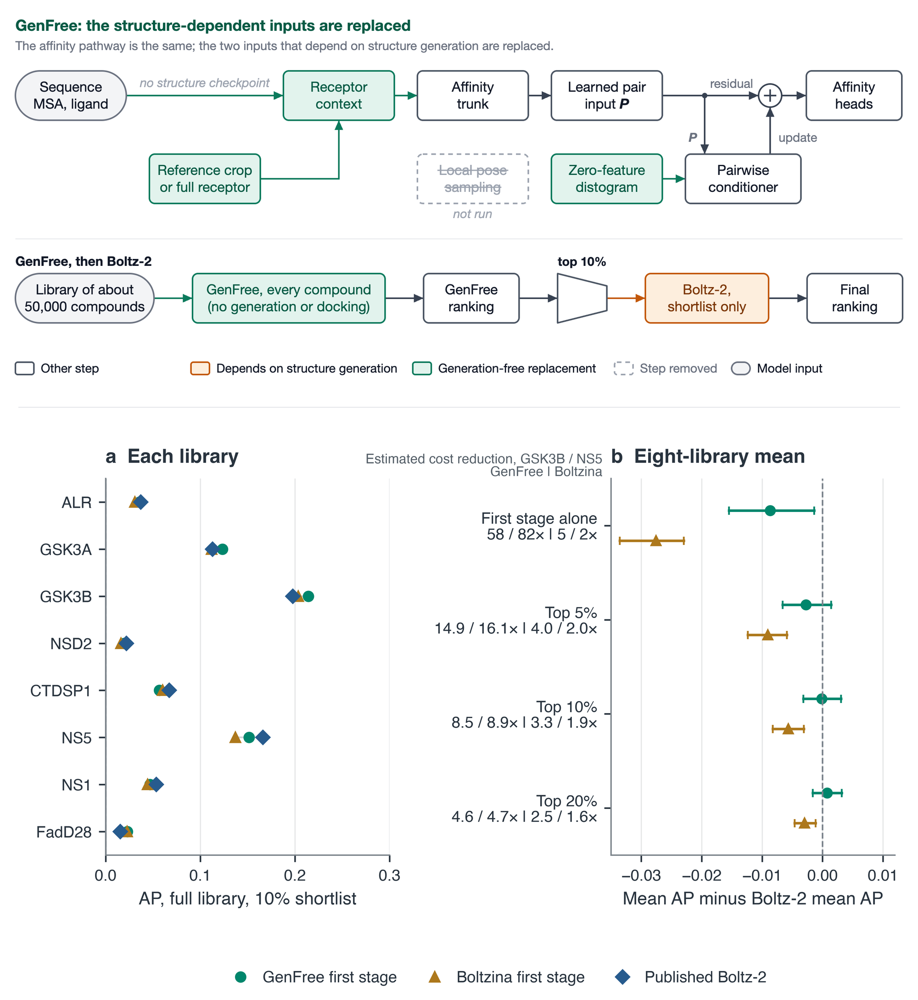
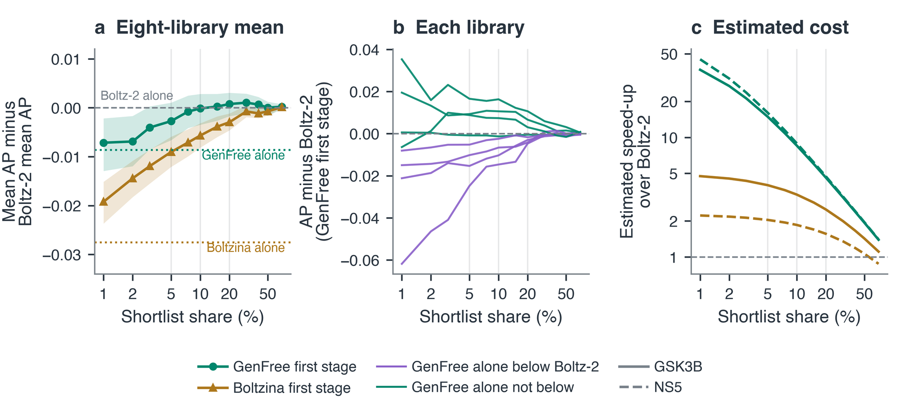

# Boltz-GenFree

Structure-generation-free Boltz-2 affinity screening.

Boltz-GenFree (GenFree) runs the released Boltz-2 affinity trunk and heads directly
from processed receptor and ligand inputs. It builds no structure for any candidate and
writes compact scores for large, resumable virtual screens. It is intended as a cheap
first stage: rank the whole library with GenFree, then spend the full Boltz-2 pipeline
only on the top of the ranking.



## Performance



## Install

Python 3.10 or newer. The package is not on PyPI; install from a tagged release.

```bash
git clone https://github.com/N283T/boltz-genfree.git
cd boltz-genfree
uv sync --frozen --extra cuda      # --extra cuda12 for CUDA 12 PyTorch builds
source .venv/bin/activate
```

The Boltz-2 affinity checkpoint is downloaded on first use; weights are not
redistributed.

## Usage

Write a config with one protein and one ligand source:

```yaml
version: 1

target:
  sequence: YOUR_PROTEIN_SEQUENCE
  msa: ./target.a3m          # or auto / empty
  crop:                      # optional when the complete receptor fits
    reference: ./reference-complex.cif
    reference_protein: A
    reference_ligand: L

ligands:
  csv: ./library.csv
  id_column: id
  smiles_column: smiles

output_dir: ./screen-output
```

```bash
boltz-genfree screen screen.yaml --prepare-only   # dry run: validate the inputs
boltz-genfree screen screen.yaml                  # run; scores are written to scores.csv
```

A re-run with the same inputs resumes where it stopped. Ligand sources, options, size
limits, the optional reference bootstrap and fine-tuned heads are described in
[docs/usage.md](docs/usage.md) and [docs/finetuning.md](docs/finetuning.md).

## WebGPU (experimental)

`webgpu/` runs the full structure-free chain on WebGPU, in Node and in a browser:
featurisation, the Boltz-2 trunk (through a [LocalFold](https://github.com/sokrypton/localfold)
checkout) and the affinity module, from a protein sequence (+ optional A3M) and a ligand
SMILES. With exact PyTorch features it agrees with GenFree to |value diff| <= 1e-3; with its
own featuriser to within GenFree's seed-to-seed spread. See [docs/webgpu.md](docs/webgpu.md)
for setup, tolerances, timings and limits.

## License

[MIT License](LICENSE). Derived from [Boltz](https://github.com/jwohlwend/boltz) and
[boltz-community](https://github.com/Novel-Therapeutics/boltz-community); history is
preserved.

## Citation

Release v0.1.0 is archived on Zenodo:
[10.5281/zenodo.24400635](https://doi.org/10.5281/zenodo.24400635)
(all versions: [10.5281/zenodo.24400634](https://doi.org/10.5281/zenodo.24400634)).
The curated evidence and analysis code for the associated manuscript are archived at
[10.5281/zenodo.23949585](https://doi.org/10.5281/zenodo.23949585). See
[CITATION.cff](CITATION.cff) for citation metadata.

## Development

```bash
uv sync --frozen --extra test --extra lint
pytest -q
```
